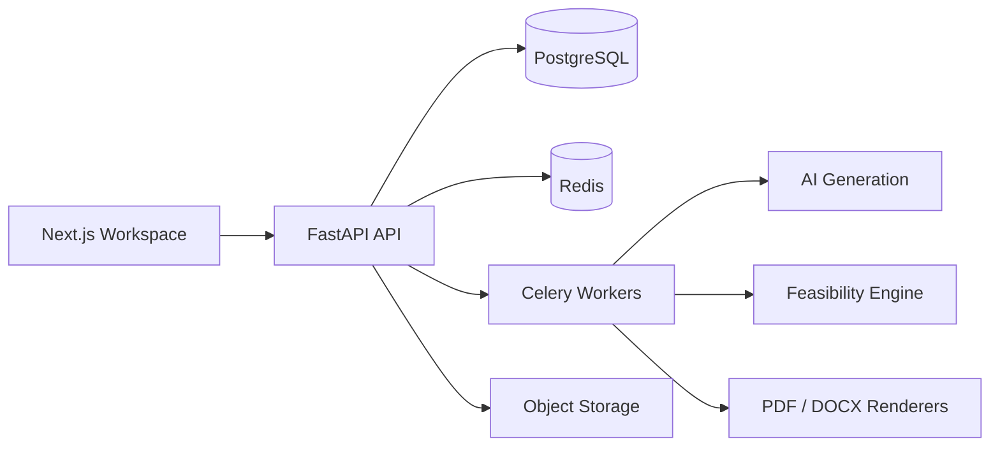

# PaperGen

<div align="center">

### The intelligent question-paper studio

**Curriculum to classroom-ready paper — designed, calibrated, and exportable.**

[](./backend)
[](./frontend)
[](./infra)
[](./backend/app/workers)

<br />

**From curriculum planning to moderated exports — one connected workspace.**

</div>

---

## What is PaperGen?

PaperGen is a full-stack platform for creating, reviewing, and exporting
curriculum-aligned assessments. It combines structured question-bank management,
AI-assisted generation, feasibility checks, approval workflows, notifications,
templates, and PDF/DOCX publishing.

<table>
  <tr>
    <td width="50%">

### Build
- Curriculum and chapter management
- Question-bank import and validation
- Paper templates and generation plans
- Difficulty, Bloom, and topic controls

    </td>
    <td width="50%">

### Govern
- Role-based access and tenant isolation
- Approval and review queues
- Audit trails and generation lineage
- Real-time paper status updates

    </td>
  </tr>
  <tr>
    <td>

### Generate
- Solver-backed paper assembly
- Resumable background jobs
- Feasibility recommendations
- Multipart and fallback question handling

    </td>
    <td>

### Deliver
- PDF and DOCX exports
- Signed download artifacts
- Notification centre
- Frontend dashboard and paper editor

    </td>
  </tr>
</table>

---

## Platform map



<details>
<summary><strong>Explore the repository</strong></summary>

| Area | Responsibility |
|---|---|
| [`backend/`](./backend) | API, domain modules, models, migrations, workers, and tests |
| [`frontend/`](./frontend) | Next.js application, dashboard, paper editor, and feature UI |
| [`infra/`](./infra) | Docker Compose services and PostgreSQL initialization |
| [`scripts/`](./scripts) | Local infrastructure, API, import, and release helpers |
| [`docs/docs/`](./docs/docs) | Architecture and platform documentation |
| [`openapi.json`](./openapi.json) | Generated API contract |

</details>

---

## Quick start

> Recommended environment: Windows PowerShell, Python 3.11+, Node.js 20+, Docker Desktop.

### 1. Configure the environment

```powershell
Copy-Item .env.example .env
Copy-Item infra/.env.example infra/.env
```

Fill in local secrets and service values in `infra/.env` and `.env`.
Never commit real credentials or environment-specific secret files.

### 2. Start infrastructure

```powershell
docker compose -f infra/docker-compose.yml --env-file infra/.env up -d
```

### 3. Start the API

```powershell
cd backend
python -m venv .venv
.\.venv\Scripts\Activate.ps1
python -m pip install -e ".[dev]"
alembic upgrade head
uvicorn app.main:app --reload --port 8000
```

API documentation is available locally at:

- Swagger UI: `http://localhost:8000/api/docs`
- Health: `http://localhost:8000/health`

### 4. Start the web application

Open a second terminal:

```powershell
cd frontend
npm install
npm run dev
```

The web application will be available at `http://localhost:3000`.

---

## Core workflows

<details open>
<summary><strong>Import and organize curriculum</strong></summary>

Use the curriculum studio to create boards, grades, subjects, chapters, and
question-bank records. JSON import examples are included as seed and validation
fixtures.

</details>

<details>
<summary><strong>Assemble and review a paper</strong></summary>

Create a paper plan, choose templates and chapter constraints, run generation,
then review, edit, approve, and publish the final assessment.

</details>

<details>
<summary><strong>Export the final paper</strong></summary>

Generate PDF or DOCX artifacts from the paper service and distribute them through
the signed export workflow.

</details>

---

## Validation

Run the smallest relevant suite while developing:

```powershell
# Backend
cd backend
pytest

# Frontend
cd frontend
npm run typecheck
npm test
npm run build
```

---

## Engineering defaults

- Keep secrets in environment variables or a secret manager.
- Run database migrations before starting a deployed API instance.
- Use PostgreSQL-backed tenants and RLS for organization isolation.
- Treat generated artifacts as disposable derived data.
- Keep proof output, scratch data, local databases, caches, and downloaded binaries
  out of version control.
