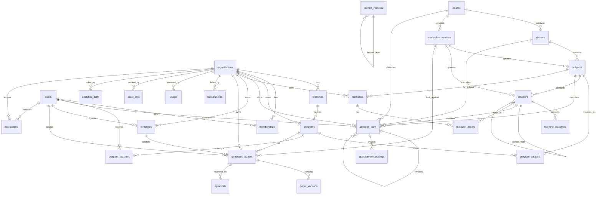

# 03 Database Design

## Overview

This document converts the finalized high-level database architecture into a production-ready low-level design for the AI-powered Question Paper Generation SaaS platform.

The design keeps the architecture intact and does not introduce unnecessary new tables. The database remains centered on questions, with papers as derived artifacts.

## Design Principles

- Questions are the core entity.
- Papers are projections of selected questions.
- Multi-tenant isolation is mandatory.
- Versioning is required for questions, prompts, embeddings, curriculum, and papers.
- Soft deletes are preferred for business entities.
- Audit logs and usage records are append-only.
- PostgreSQL is the transactional source of truth.
- SQLAlchemy 2.x (async) is the application mapping layer; Alembic owns migrations (ADR-006).
- Retrieval at MVP is metadata filter + `tsvector` full-text + `pg_trgm` trigram. **pgvector is deferred**
  and adopted only on measured recall evidence (ADR-007); the `question_embeddings` table and the
  `vector` extension are created at that point, not before.
- UUID primary keys are used throughout.
- Optimistic locking is used on mutable records that can be edited concurrently.

## 1. Domain Analysis

### Business domains

- Tenancy and access control
- Curriculum management
- Question lifecycle management
- Textbook ingestion and source extraction
- Paper blueprinting and generation
- AI prompt governance and validation
- Billing and usage metering
- Audit and analytics

### Aggregates

- Organization
- CurriculumVersion
- QuestionBank entry with lineage
- Textbook
- GeneratedPaper
- PromptVersion
- Subscription
- Program

### Value Objects

- Marks
- Difficulty mix
- Bloom mix
- Source mix
- Duration
- Language
- Question pattern
- Taxonomy scope
- Embedding model reference
- Prompt model reference

## 2. Entity Identification

### Core entities

- organizations
- branches
- users
- memberships
- boards
- classes
- subjects
- chapters
- learning_outcomes
- curriculum_versions
- programs
- program_subjects
- program_teachers
- question_bank
- question_embeddings
- textbooks
- textbook_assets
- templates
- generated_papers
- paper_versions
- approvals
- subscriptions
- usage
- audit_logs
- analytics_daily
- prompt_versions
- notifications

### Supporting entities

- Rely on constrained text values for source, type, difficulty, bloom, role, status, and plan unless the domain vocabulary expands faster than schema migrations.
- Keep search and analytics as derived read models rather than source-of-truth entities.

## 3. Relationship Design

### One-to-many

- organizations → branches
- organizations → memberships
- organizations → programs
- organizations → question_bank
- organizations → textbooks
- organizations → templates
- organizations → generated_papers
- organizations → subscriptions
- organizations → usage
- organizations → audit_logs
- organizations → notifications
- users → notifications
- boards → classes
- classes → subjects
- subjects → chapters
- chapters → learning_outcomes
- curriculum_versions → subjects
- curriculum_versions → chapters
- programs → generated_papers
- textbooks → textbook_assets
- generated_papers → paper_versions
- generated_papers → approvals
- question_bank → question_embeddings

### Many-to-many

- programs ↔ subjects through program_subjects
- programs ↔ users through program_teachers
- questions ↔ taxonomy/scoped classification via JSONB and arrays in the finalized architecture, with future normalization possible if needed

### Self-referencing

- chapters.derived_from_chapter_id
- question_bank.root_question_id and question_bank.previous_version_id
- question_embeddings.previous_embedding_id
- prompt_versions.previous_prompt_version_id

## 4. Database Architecture

### Table groups

#### Identity and tenancy
- organizations
- branches
- users
- memberships

#### Curriculum
- boards
- classes
- subjects
- chapters
- learning_outcomes
- curriculum_versions

#### Programs
- programs
- program_subjects
- program_teachers

#### Questions
- question_bank
- question_embeddings

#### Textbooks
- textbooks
- textbook_assets

#### Papers
- templates
- generated_papers
- paper_versions
- approvals

#### Billing and operations
- subscriptions
- usage
- audit_logs
- analytics_daily
- notifications

#### AI governance
- prompt_versions

### Normalization

- Core transactional tables should remain in 3NF.
- Render snapshots, analytics rollups, and search projections should be denormalized by design.
- Do not store mutable canonical content only inside JSON blobs.
- Keep provenance separate from content when possible.

## 5. Table-by-Table Design

### organizations

Purpose: tenant master.

Columns:
- id UUID, PK
- name text, required
- org_type text, required
- region text, required
- subscription_id UUID, nullable
- settings JSONB, required
- status text, required
- created_at timestamptz, required
- updated_at timestamptz, required
- deleted_at timestamptz, nullable
- row_version integer, required

Foreign keys:
- subscription_id references subscriptions.id, optional current reference

Constraints:
- org_type constrained to approved tenant types
- status constrained to lifecycle values
- row_version positive

Unique constraints:
- none beyond id unless a tenant code is later introduced

Indexes:
- status
- region
- org_type

Cascade rules:
- hard delete should be avoided
- if hard delete is ever used, tenant-owned child records should cascade by org_id FKs

Default values:
- id generated UUID
- settings default empty JSON object
- status active
- timestamps now()
- row_version 1

### branches

Purpose: optional organization subdivision.

Columns:
- id UUID, PK
- org_id UUID, required
- name text, required
- region text, nullable
- status text, required
- created_at timestamptz, required
- updated_at timestamptz, required
- deleted_at timestamptz, nullable
- row_version integer, required

Foreign keys:
- org_id references organizations.id

Constraints:
- unique(org_id, name)
- status constrained to lifecycle values

Indexes:
- org_id
- status

Cascade rules:
- deleting an organization cascades branches
- deleting a branch should typically null out branch_id on dependent rows

Default values:
- status active
- timestamps now()
- row_version 1

### users

Purpose: identity record.

Columns:
- id UUID, PK
- email citext, required
- password_hash text, nullable (null for SSO-only accounts)
- full_name text, required — ORM attribute `fullName`
- status text, required
- created_at timestamptz, required
- updated_at timestamptz, required
- deleted_at timestamptz, nullable
- row_version integer, required

Constraints:
- email unique globally
- status constrained to `active` / `disabled` / `suspended`

Indexes:
- status

Drift note (ADR-012): the column is `full_name`, not `name` — the implemented schema already carries
`fullName` and renaming a populated column is more expensive than correcting this document.
`status` is retained here and is an additive migration on the implementation: authentication depends on
it (a disabled or suspended account must fail login without deleting the identity record, per FR-1.6
and AC-1 "a revoked membership loses access on the next request"). Add it as nullable, backfill
`active`, then set NOT NULL.

Cascade rules:
- prefer soft delete
- historical references should not be destroyed casually

Default values:
- status active
- timestamps now()
- row_version 1

### memberships

Purpose: organization-scoped access and role assignment.

Columns:
- id UUID, PK
- user_id UUID, required
- org_id UUID, required
- branch_id UUID, nullable — null means org-wide access
- role text, required
- status text, required
- created_at timestamptz, required
- updated_at timestamptz, required
- deleted_at timestamptz, nullable
- row_version integer, required

Foreign keys:
- user_id references users.id
- org_id references organizations.id
- branch_id references branches.id

Constraints:
- unique(user_id, org_id)
- role constrained to the RBAC vocabulary in §7.2: `teacher`, `coaching_admin`, `super_admin`
- status constrained to `active` / `invited` / `suspended`

Indexes:
- org_id
- role
- branch_id
- user_id
- status

Cascade rules:
- organization and user deletion may cascade only in hard-delete maintenance scenarios
- deleting a branch should set branch_id to null

Default values:
- status active (`invited` for memberships created by an unaccepted invitation)
- timestamps now()
- row_version 1

Drift note (ADR-012): `status` exists in the implementation and was previously undocumented — it is
documented here rather than dropped, because the invitation flow (FR-1.5, "pending invites expire")
needs a membership row that does not yet grant access. `branch_id` is documented but not yet
implemented; it is an additive nullable FK required for branch-scoped access (`programs.branch_id`
already exists and branch scoping is part of the guard chain in `07_Backend_Architecture.md` §8.2).

### boards

Purpose: global board reference data.

Columns:
- id UUID, PK
- code text, required
- name text, required

Constraints:
- code unique

Indexes:
- code

Cascade rules:
- restrict deletion when curriculum records exist

Default values:
- id generated UUID

### classes

Purpose: board-specific grade/class definition.

Columns:
- id UUID, PK
- board_id UUID, required
- name text, required

Foreign keys:
- board_id references boards.id

Constraints:
- unique(board_id, name)

Indexes:
- board_id

Cascade rules:
- restrict deletion when dependent subjects exist

Default values:
- id generated UUID

### subjects

Purpose: subject definition.

Columns:
- id UUID, PK
- class_id UUID, required
- curriculum_version_id UUID, nullable
- name text, required

Foreign keys:
- class_id references classes.id
- curriculum_version_id references curriculum_versions.id

Constraints:
- unique(class_id, name)

Indexes:
- class_id
- curriculum_version_id

Cascade rules:
- restrict deletion when dependent chapters exist

Default values:
- id generated UUID

### chapters

Purpose: syllabus node and retrieval anchor.

Columns:
- id UUID, PK
- subject_id UUID, required
- curriculum_version_id UUID, nullable
- seq integer, required
- title text, required
- derived_from_chapter_id UUID, nullable

Foreign keys:
- subject_id references subjects.id
- curriculum_version_id references curriculum_versions.id
- derived_from_chapter_id references chapters.id

Constraints:
- unique(subject_id, seq)

Indexes:
- subject_id
- curriculum_version_id
- derived_from_chapter_id
- composite(curriculum_version_id, subject_id, seq)

Cascade rules:
- restrict deletion if outcomes, questions, or textbook assets still reference the chapter

Default values:
- id generated UUID

### learning_outcomes

Purpose: chapter-level learning objective records.

Columns:
- id UUID, PK
- chapter_id UUID, required
- code text, nullable
- description text, required

Foreign keys:
- chapter_id references chapters.id

Constraints:
- optional unique(chapter_id, code) if codes are consistently populated

Indexes:
- chapter_id

Cascade rules:
- restrict deletion or soft delete with the parent chapter

Default values:
- id generated UUID

### curriculum_versions

Purpose: syllabus version boundary.

Columns:
- id UUID, PK
- board_id UUID, required
- academic_year text, required
- label text, nullable
- status text, required
- effective_from date, nullable
- source_ref text, nullable
- created_at timestamptz, required
- updated_at timestamptz, required
- deleted_at timestamptz, nullable
- row_version integer, required

Foreign keys:
- board_id references boards.id

Constraints:
- unique(board_id, academic_year)
- status constrained to draft/active/superseded

Indexes:
- board_id
- status
- effective_from

Cascade rules:
- restrict deletion when dependent subjects or chapters exist

Default values:
- status draft
- timestamps now()
- row_version 1

### programs

Purpose: institute-owned batch or program.

Columns:
- id UUID, PK
- org_id UUID, required
- branch_id UUID, nullable
- name text, required
- exam_target text, nullable
- academic_year text, nullable
- status text, required
- created_at timestamptz, required
- updated_at timestamptz, required
- deleted_at timestamptz, nullable
- row_version integer, required

Foreign keys:
- org_id references organizations.id
- branch_id references branches.id

Constraints:
- unique(org_id, branch_id, name)
- status constrained to active lifecycle values

Indexes:
- org_id
- branch_id
- exam_target
- status

Cascade rules:
- org deletion cascades programs
- deleting a branch should set branch_id to null

Default values:
- status active
- timestamps now()
- row_version 1

### program_subjects

Purpose: bridge between programs and subjects.

Columns:
- program_id UUID, required
- subject_id UUID, required

Primary key:
- composite(program_id, subject_id)

Foreign keys:
- program_id references programs.id
- subject_id references subjects.id

Indexes:
- subject_id

Cascade rules:
- program delete cascades

### program_teachers

Purpose: bridge between programs and users.

Columns:
- program_id UUID, required
- user_id UUID, required

Primary key:
- composite(program_id, user_id)

Foreign keys:
- program_id references programs.id
- user_id references users.id

Indexes:
- user_id

Cascade rules:
- program delete cascades

### question_bank

Purpose: core question record with immutable version lineage.

Columns:
- id UUID, PK
- root_question_id UUID, nullable
- previous_version_id UUID, nullable
- version_number integer, required
- is_current boolean, required
- org_id UUID, nullable
- scope text, required
- source text, required
- board_id UUID, nullable
- class_id UUID, nullable
- subject_id UUID, nullable
- chapter_id UUID, nullable
- qtype text, required
- marks numeric(4,1), required
- difficulty text, required
- bloom text, nullable
- language text, required
- stem text, required
- options JSONB, nullable
- answer JSONB, nullable
- rubric JSONB, nullable
- learning_outcome_ids UUID[], required with default empty array
- competency_ids UUID[], required with default empty array
- meta JSONB, required with default empty object
- content_hash text, required
- status text, required
- created_by UUID, nullable
- created_at timestamptz, required
- updated_at timestamptz, required
- deleted_at timestamptz, nullable
- row_version integer, required

Foreign keys:
- root_question_id self-references question_bank.id
- previous_version_id self-references question_bank.id
- org_id references organizations.id
- board_id references boards.id
- class_id references classes.id
- subject_id references subjects.id
- chapter_id references chapters.id
- created_by references users.id

Constraints:
- source constrained to institute_bank/textbook/intext/previous_year/ai_generated
- scope constrained to global/org/branch
- qtype constrained to approved question types
- difficulty constrained to easy/medium/hard
- status constrained to draft/approved/rejected/archived
- version_number positive
- if scope is global, org_id must be null
- if scope is org, org_id must be present
- unique(root_question_id, version_number)
- partial unique(root_question_id) where is_current = true

Indexes:
- composite retrieval index on org_id, scope, source, board_id, class_id, subject_id, chapter_id, qtype, difficulty, status
- content_hash
- root_question_id
- previous_version_id
- created_by, created_at
- GIN on search document built from stem, answer, and rubric
- GIN on learning_outcome_ids
- GIN on competency_ids
- trigram on stem

Cascade rules:
- prefer soft delete
- if hard delete is ever used, embeddings should cascade, while lineage references should generally be restricted or set null to preserve history

Default values:
- version_number 1
- is_current true
- scope global for seeded shared content
- meta empty JSON object
- status approved for curated content or draft for authoring flows
- timestamps now()
- row_version 1

### question_embeddings

Purpose: embedding sidecar for questions.

**Deferred (ADR-007).** This table and the `vector` extension are **not created at MVP**. MVP retrieval
runs on the metadata filter + `tsvector` + `pg_trgm` path. The table is specified here so that adopting
ANN later is an additive migration (step 7 of §9) rather than a redesign. Everything below applies from
the moment the adoption trigger fires — a measured paraphrase-recall gap in the eval suite.

Columns:
- id UUID, PK
- question_id UUID, required
- model text, required
- embedding vector, required
- dimensions smallint, required
- checksum text, required
- is_current boolean, required
- previous_embedding_id UUID, nullable
- created_at timestamptz, required
- updated_at timestamptz, required
- deleted_at timestamptz, nullable
- row_version integer, required

Foreign keys:
- question_id references question_bank.id
- previous_embedding_id self-references question_embeddings.id

Constraints:
- one current embedding per question per model
- dimensions must match the model contract

Vector width (ADR-008 — Gemini embeddings):
- The Gemini embedding model emits **3072** dimensions by default and supports Matryoshka truncation
  to 1536 or 768 without retraining.
- pgvector's HNSW and IVFFlat indexes accept at most **2000** dimensions for the `vector` type, so a
  raw 3072-dim vector **cannot be ANN-indexed**. The column is therefore declared `vector(1536)` and
  the provider adapter truncates to 1536 and re-normalises before insert.
- Alternative, if full fidelity is ever required: `halfvec(3072)`, whose HNSW limit is 4000 dimensions,
  at the cost of half-precision elements. Record whichever is chosen in `dimensions` per row so a
  future migration can distinguish generations of vectors.
- `dimensions` is stored per row precisely so the width is a data property, not a hardcoded assumption.

Indexes:
- HNSW on embedding
- question_id, model
- is_current
- checksum

Cascade rules:
- cascade only in hard-delete maintenance scenarios
- soft delete is the normal lifecycle

Default values:
- is_current true
- timestamps now()
- row_version 1

### textbooks

Purpose: source document container.

Columns:
- id UUID, PK
- org_id UUID, nullable
- subject_id UUID, nullable
- file_key text, required
- status text, required
- pages integer, nullable
- created_at timestamptz, required
- updated_at timestamptz, required
- deleted_at timestamptz, nullable
- row_version integer, required

Foreign keys:
- org_id references organizations.id
- subject_id references subjects.id

Constraints:
- status constrained to uploaded/ocr/parsed/embedded/failed style lifecycle values
- optional unique(org_id, file_key)

Indexes:
- org_id
- subject_id
- status
- created_at

Cascade rules:
- org deletion cascades org-owned textbooks

Default values:
- status uploaded
- timestamps now()
- row_version 1

### textbook_assets

Purpose: extracted textbook content and media.

Columns:
- id UUID, PK
- textbook_id UUID, required
- chapter_id UUID, nullable
- kind text, required
- s3_key text, nullable
- data JSONB, nullable
- page integer, nullable
- created_at timestamptz, required
- updated_at timestamptz, required
- deleted_at timestamptz, nullable
- row_version integer, required

Foreign keys:
- textbook_id references textbooks.id
- chapter_id references chapters.id

Constraints:
- kind constrained to paragraph/exercise/question/diagram/table/activity/formula style values

Indexes:
- textbook_id
- chapter_id
- kind
- page

Cascade rules:
- textbook delete cascades assets

Default values:
- timestamps now()
- row_version 1

### templates

Purpose: reusable paper layout and branding.

Columns:
- id UUID, PK
- org_id UUID, nullable
- name text, required
- layout JSONB, required
- created_by UUID, nullable
- status text, required
- created_at timestamptz, required
- updated_at timestamptz, required
- deleted_at timestamptz, nullable
- row_version integer, required

Foreign keys:
- org_id references organizations.id
- created_by references users.id

Constraints:
- name unique within owner scope
- status constrained to active/draft/archived style values

Indexes:
- org_id
- status
- created_at

Cascade rules:
- org deletion cascades org-owned templates

Default values:
- status active
- timestamps now()
- row_version 1

### generated_papers

Purpose: paper aggregate and blueprint snapshot.

Columns:
- id UUID, PK
- org_id UUID, required
- created_by UUID, required
- program_id UUID, nullable
- blueprint JSONB, required
- curriculum_version_id UUID, nullable
- template_id UUID, nullable
- title text, required
- total_marks numeric(5,1), nullable
- duration_min integer, nullable
- status text, required
- created_at timestamptz, required
- updated_at timestamptz, required
- deleted_at timestamptz, nullable
- row_version integer, required

Foreign keys:
- org_id references organizations.id
- created_by references users.id
- program_id references programs.id
- curriculum_version_id references curriculum_versions.id
- template_id references templates.id

Constraints:
- status constrained to draft/submitted/review/approved/rejected

Indexes:
- org_id
- status
- created_at
- program_id
- created_by, created_at

Cascade rules:
- soft delete preferred
- paper_versions and approvals cascade from generated_papers in hard-delete scenarios

Default values:
- status draft
- timestamps now()
- row_version 1

### paper_versions

Purpose: immutable renderable paper versions.

Columns:
- id UUID, PK
- paper_id UUID, required
- label text, required
- content JSONB, required
- answer_key JSONB, nullable
- pdf_key text, nullable
- docx_key text, nullable
- created_at timestamptz, required
- updated_at timestamptz, nullable

Foreign keys:
- paper_id references generated_papers.id

Constraints:
- unique(paper_id, label)

Indexes:
- paper_id
- created_at

Cascade rules:
- generated_papers delete cascades versions

Default values:
- created_at now()

### approvals

Purpose: workflow trail.

Columns:
- id UUID, PK
- paper_id UUID, required
- reviewer_id UUID, nullable
- action text, required
- comment text, nullable
- created_at timestamptz, required

Foreign keys:
- paper_id references generated_papers.id
- reviewer_id references users.id

Constraints:
- action constrained to workflow states

Indexes:
- paper_id, created_at
- reviewer_id, created_at

Cascade rules:
- paper delete cascades approvals in hard-delete scenarios

Default values:
- created_at now()

### subscriptions

Purpose: billing contract.

Columns:
- id UUID, PK
- org_id UUID, required
- plan text, required
- seats integer, nullable
- status text, required
- period_start date, nullable
- period_end date, nullable
- provider_ref text, nullable
- created_at timestamptz, required
- updated_at timestamptz, required
- deleted_at timestamptz, nullable
- row_version integer, required

Foreign keys:
- org_id references organizations.id

Constraints:
- plan constrained to plan values
- status constrained to active/past_due/canceled/suspended style values
- provider_ref unique if present

Indexes:
- org_id
- status
- period_end

Cascade rules:
- prefer soft delete

Default values:
- status active
- timestamps now()
- row_version 1

### usage

Purpose: append-only metering.

Columns:
- id bigint identity, PK
- org_id UUID, required
- user_id UUID, nullable
- metric text, required
- qty numeric, required
- ts timestamptz, required

Foreign keys:
- org_id references organizations.id
- user_id references users.id

Constraints:
- metric constrained to approved meter names
- qty positive

Indexes:
- org_id, metric, ts
- user_id, ts

Cascade rules:
- no normal hard delete
- time partition lifecycle handles archival

Default values:
- ts now()

### audit_logs

Purpose: append-only compliance trail.

Columns:
- id bigint identity, PK
- org_id UUID, nullable
- actor_id UUID, nullable
- action text, required
- entity text, nullable
- entity_id UUID, nullable
- ip inet, nullable
- meta JSONB, nullable
- ts timestamptz, required

Foreign keys:
- org_id references organizations.id
- actor_id references users.id

Constraints:
- action required and normalized

Indexes:
- org_id, ts
- actor_id, ts
- entity, entity_id
- action, ts

Cascade rules:
- no normal hard delete
- time partition lifecycle handles archival

Default values:
- ts now()

### analytics_daily

Purpose: daily reporting rollup.

Columns:
- org_id UUID, required
- day date, required
- papers integer, required
- ai_questions integer, required
- retrieved_questions integer, required
- avg_difficulty numeric, required
- coverage JSONB, nullable
- created_at timestamptz, required
- updated_at timestamptz, required

Primary key:
- composite(org_id, day)

Foreign keys:
- org_id references organizations.id

Indexes:
- day
- org_id

Cascade rules:
- soft delete not usually used; rollups are rebuildable

Default values:
- timestamps now()

### notifications

Purpose: durable delivery and read-state record for the notification catalogue NT-1 … NT-15.

This table closes a gap: `02_System_Architecture.md` and `07_Backend_Architecture.md` both assign the
Notifications module a "notification log table", which previously had no definition here. It is
documented rather than invented — the module, its endpoints (`GET /notifications`,
`POST /notifications/:id/read`), and its read-state behaviour were already specified.

Columns:
- id UUID, PK
- org_id UUID, required
- user_id UUID, required — the recipient
- code text, required — the catalogue id, e.g. `NT-3`
- channel text, required
- title text, required
- body text, nullable
- link text, nullable — deep link to the target screen
- entity text, nullable
- entity_id UUID, nullable
- dedup_key text, required — suppresses duplicate delivery for the same event and recipient
- status text, required
- read_at timestamptz, nullable
- created_at timestamptz, required
- updated_at timestamptz, required

Foreign keys:
- org_id references organizations.id
- user_id references users.id

Constraints:
- code constrained to the NT-1 … NT-15 catalogue in `01_Product_Requirements.md`
- channel constrained to `in_app` / `email` (`sms` and `push` are reserved, not implemented)
- status constrained to `pending` / `sent` / `failed`
- unique(user_id, dedup_key) — enforces the "duplicate notifications are suppressed" rule

Indexes:
- user_id, created_at
- org_id, created_at
- user_id, read_at (partial, where read_at is null — powers the unread count)
- dedup_key

Cascade rules:
- org and user deletion cascade only in hard-delete maintenance scenarios

Default values:
- status pending
- timestamps now()

### prompt_versions

Purpose: AI prompt registry and release tracking.

Columns:
- id UUID, PK
- task text, required
- version integer, required
- template_ref text, required
- model text, required
- author UUID, nullable
- eval_score JSONB, nullable
- status text, required
- previous_prompt_version_id UUID, nullable
- created_at timestamptz, required
- updated_at timestamptz, required
- deleted_at timestamptz, nullable
- row_version integer, required

Foreign keys:
- author references users.id
- previous_prompt_version_id references prompt_versions.id

Constraints:
- unique(task, version)
- partial unique(task, model) where status = active
- status constrained to candidate/active/retired

Indexes:
- task
- model
- status
- created_at

Cascade rules:
- retire by status, not delete

Default values:
- status candidate
- timestamps now()
- row_version 1

## 6. ER Diagram

`question_embeddings` is shown for completeness; it is created only when pgvector is adopted (ADR-007).

## 7. Data Dictionary

The table-by-table section above serves as the per-column data dictionary. This section pins the
**controlled vocabularies** that more than one document depends on, so that no other document has to
restate them from memory.

### 7.1 Identity and tenancy columns

| Table | Column | Type | Null | Notes |
|---|---|---|---|---|
| users | full_name | text | NOT NULL | ORM attribute `fullName`. Not `name` — see the drift note in §5. |
| users | status | text | NOT NULL | `active` / `disabled` / `suspended`. Default `active`. |
| memberships | role | text | NOT NULL | See §7.2. |
| memberships | status | text | NOT NULL | `active` / `invited` / `suspended`. Default `active`. |
| memberships | branch_id | UUID | NULL | Null = org-wide access. Additive nullable FK to `branches.id`. |

### 7.2 RBAC role vocabulary (ADR-011)

`memberships.role` is a **constrained text column, not a native PostgreSQL ENUM**, precisely so that
adding a role is a one-line CHECK-constraint migration rather than an `ALTER TYPE` that locks the
table and cannot be reversed cleanly.

**Implemented at MVP — exactly three values:**

| Value | Persona (display name) | Scope |
|---|---|---|
| `teacher` | Teacher | One organization, optionally narrowed to assigned programs and subjects |
| `coaching_admin` | Coaching Admin | One organization, full authority over its branches, users, and content |
| `super_admin` | Super Admin | Cross-tenant platform operator; every cross-tenant read is audited (BR-7, BR-11) |

**Reserved — documented, deliberately not implemented at MVP:**

| Value | Intended meaning | Why deferred |
|---|---|---|
| `hod` | Head of department; approves within a subject/department slice | Needs a department dimension that does not exist in the schema; `coaching_admin` + BR-6 covers approval today |
| `reviewer` | Approve-only, cannot author | Separation of duties is already enforced behaviourally by BR-6 (author ≠ sole approver); a distinct role adds a permission axis without a distinct workflow yet |
| `viewer` | Read-only observer | No customer requirement has been recorded for it |

Adding a reserved value later requires: extend the CHECK constraint, extend the capability matrix in
`07_Backend_Architecture.md` §8.1, extend the client capability mirror in
`08_Frontend_Architecture.md` §7.2, and add a route group if the role needs its own surfaces. No table
or column changes. This is what "extendable enum" means concretely.

### 7.3 Other controlled vocabularies

| Column | Values |
|---|---|
| `question_bank.source` | `institute_bank`, `textbook`, `intext`, `previous_year`, `ai_generated` |
| `question_bank.scope` | `global`, `org` |
| `question_bank.difficulty` | `easy`, `medium`, `hard` |
| `question_bank.bloom` | `remember`, `understand`, `apply`, `analyze`, `evaluate`, `create` |
| `question_bank.status` | `draft`, `approved`, `rejected`, `archived` |
| `question_bank.qtype` | The 13 types QT-1 … QT-13 in `01_Product_Requirements.md`: `mcq`, `true_false`, `one_word`, `fill_blank`, `short_answer`, `long_answer`, `assertion_reason`, `case_study`, `numerical`, `diagram_based`, `match`, `very_short_answer`, `source_based` |
| `textbooks.status` | `uploaded`, `ocr`, `parsed`, `embedded`, `failed` — persisted values only (see `05_Textbook_Ingestion.md` §15) |
| `textbook_assets.kind` | `paragraph`, `exercise`, `question`, `diagram`, `table`, `activity`, `formula` |
| `generated_papers.status` | `draft`, `submitted`, `review`, `approved`, `rejected` |
| `prompt_versions.status` | `candidate`, `active`, `retired` |
| `notifications.code` | NT-1 … NT-15 |

> **Amendment (P1-T4, 2026-08-19): `question_bank.scope` lost the value `branch`.**
> This row previously read `global`, `org`, `branch`. The third value was removed by
> Alembic revision `0023`, and this is the one place in P1-T4 where the implementation
> deliberately contradicts this document rather than interpreting it.
>
> The reason is that `branch` was unusable as specified. §5's `question_bank` column list
> has no `branch_id`, so a row could record *that* it was branch-scoped without recording
> **which** branch — leaving it indistinguishable from an org-scoped row at query time and
> unconstrained in either direction. The two conditional rules in §5 cover `global` and
> `org` only, so nothing validated a `branch` row at all.
>
> Making `branch` work is a design task, not a value: it needs a nullable `branch_id` FK
> with a decided `ON DELETE` action, a third conditional CHECK, a revision to the retrieval
> index, and an RLS visibility rule (which belongs to P1-T5). Until branch-level scoping is
> actually designed, the vocabulary states only what the schema can enforce. When it is
> designed, the value returns together with the column it needs.
>
> Consequence to know before P2: with `branch` gone, the two conditional CHECKs make
> `scope` fully derivable from `org_id IS NULL`. The column is kept because it reads
> clearly and is a better index prefix than a nullness test, but it earns its place back
> properly only if a non-org scope returns.

## 8. ORM Model Design

The application maps these tables with **SQLAlchemy 2.x declarative models using the async engine**;
schema changes are versioned with **Alembic** (ADR-006). Model names below are the Python classes.

Planned models:
- Organization
- Branch
- User
- Membership
- Board
- Class
- Subject
- Chapter
- LearningOutcome
- CurriculumVersion
- Program
- ProgramSubject
- ProgramTeacher
- QuestionBank
- Textbook
- TextbookAsset
- Template
- GeneratedPaper
- PaperVersion
- Approval
- Subscription
- Usage
- AuditLog
- AnalyticsDaily
- PromptVersion
- Notification

> **Amendment (P1-T4, 2026-08-19): the `QuestionEmbedding` entry was removed from the list
> above.**
> This section previously listed `QuestionEmbedding` among the planned models and then
> added: "`QuestionEmbedding` is defined but its migration is gated on pgvector adoption
> (ADR-007)."
>
> Those two statements cannot both hold in a codebase that runs `alembic check` in CI. A
> declarative model *is* a table in SQLAlchemy's `MetaData`; there is no "defined but not
> created" state. A model with no migration behind it makes autogenerate see a table that
> should exist and does not, so `alembic check` reports drift on a clean database — every
> run, forever, for a table nobody wants yet. A permanently red drift check is worse than
> no drift check, because it trains everyone to ignore the one signal that catches real
> schema mistakes.
>
> ADR-007's decision to defer pgvector is unchanged and is honoured more strictly: no
> `question_embeddings` table, no `QuestionEmbedding` model, and no `vector` extension.
> Revision `0007` occupies the step this table would have taken and documents what was
> given up. The model and its migration arrive **together**, in the same change, whenever
> pgvector is adopted — which is also the only order in which either is testable.
>
> Nothing about the *table* design is withdrawn: §5's `question_embeddings` specification
> stands as written, the ERD in §6 still shows it, and §9 step 7 still holds its place in
> the migration order. Only the claim that a Python model already exists is removed, because
> that was the half of the sentence CI could disprove.

Implementation notes:
- Use `relationship()` for parent-child links and `Mapped[...]` annotations throughout.
- Use composite primary keys for the join tables (`program_subjects`, `program_teachers`).
- Use `JSONB` for blueprint, layout, settings, meta, coverage, and eval_score.
- Keep question lineage as self-referential relationships (`remote_side`).
- Every session runs inside a request-scoped transaction that issues
  `SET LOCAL app.org_id = :org_id` **before any query** — never a session-level `SET`. Under PgBouncer
  transaction pooling a session-level setting leaks the tenant context to the next borrower of that
  backend, which is a silent cross-tenant read. This is enforced in the repository base class and
  covered by an isolation test that asserts the setting does not survive a pooled checkout.
- Write partitions, RLS policies, GIN/trigram indexes, generated `tsvector` columns, and (later) HNSW
  indexes as **raw SQL inside Alembic revisions**. Alembic autogenerate does not model these; hand-write
  `op.execute(...)` and keep a matching downgrade.
- Alembic revisions are forward-only in production and follow expand-migrate-contract so that a
  migration is always compatible with the previously deployed application version.

## 9. Migration Order

1. Enable PostgreSQL extensions and base types (`pgcrypto`, `citext`, `pg_trgm`). **Not `vector`** —
   see step 7.
2. Create organizations, branches, users, memberships.
3. Create boards, classes, subjects, chapters, learning_outcomes.
4. Create curriculum_versions and wire version relations.
5. Create programs, program_subjects, program_teachers.
6. Create question_bank.
7. **Gated on ADR-007:** enable the `vector` extension and create question_embeddings. Skipped at MVP;
   run only when the eval suite records a paraphrase-recall gap. Nothing earlier in this order depends
   on it, and the retrieval interface is unchanged either way.
8. Create textbooks and textbook_assets.
9. Create templates.
10. Create generated_papers.
11. Create paper_versions and approvals.
12. Create subscriptions.
13. Create usage.
14. Create audit_logs.
15. Create analytics_daily.
16. Create prompt_versions.
17. Create notifications.
18. Add indexes, constraints, RLS policies, partitions, and seed data.
19. Backfill current pointers and derived search artifacts.

### 9.1 Drift-reconciliation migrations

These three run against the partially-implemented schema and are additive and reversible (ADR-012):

| # | Change | Shape |
|---|---|---|
| D-1 | `users.status` | Add nullable → backfill `'active'` → set NOT NULL → add CHECK |
| D-2 | `memberships.branch_id` | Add nullable FK to `branches.id` → add index → no backfill (null = org-wide) |
| D-3 | `memberships.status` | Already implemented; add the CHECK constraint and index to match §5 |

No rename is required for `users.full_name`: the implementation is already correct and this document
was the side that drifted.

## 10. Final Notes

- The design preserves the finalized high-level architecture.
- No unnecessary tables were introduced. `notifications` was added because two other documents already
  required it; nothing else changed shape.
- Question versioning is handled inside question_bank using lineage columns.
- The model is suitable for a modular monolith and can evolve toward services later without a schema redesign.

## 11. Related Decisions

| ADR | Bearing on this document |
|---|---|
| [ADR-001](ADR/ADR-001-postgresql-transactional-database.md) | Why PostgreSQL is the single transactional store |
| [ADR-003](ADR/ADR-003-questions-as-core-domain-entity.md) | Why `question_bank` is the centre of the model and papers are projections |
| [ADR-004](ADR/ADR-004-soft-deletes-and-append-only-audit.md) | `deleted_at`, append-only `usage` / `audit_logs` |
| [ADR-006](ADR/ADR-006-fastapi-over-nestjs.md) | SQLAlchemy + Alembic replacing Prisma |
| [ADR-007](ADR/ADR-007-defer-pgvector-retrieval.md) | Why `question_embeddings` is deferred |
| [ADR-008](ADR/ADR-008-gemini-as-sole-ai-provider.md) | Embedding model and the `vector(1536)` width |
| [ADR-011](ADR/ADR-011-three-roles-extendable-enum.md) | The role vocabulary in §7.2 |
| [ADR-012](ADR/ADR-012-schema-drift-reconciliation.md) | `full_name`, `users.status`, `memberships.status`, `memberships.branch_id` |
